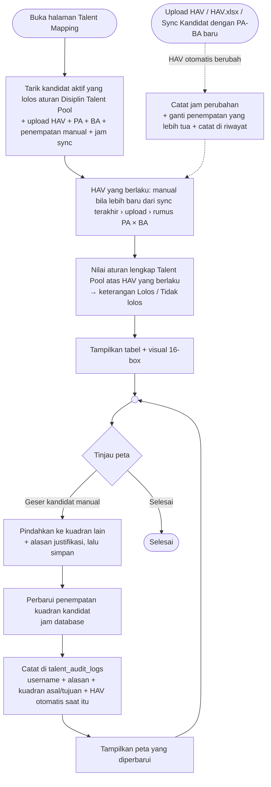

# Talent Mapping (16-box HAV) — tempat HAV dikonsolidasi

Talent Mapping adalah **satu-satunya tempat HAV seorang kandidat ditentukan**.
Tiga sumber digabung di sini — upload HAV (Excel), rumus PA × Behavioral
Assessment (BA), dan penempatan manual — menjadi satu **HAV yang berlaku**, dan
nilai itulah yang dibaca **semua** bagian aplikasi: aturan filter (Talent Pool,
Successor, Emergency), aspek HAV saat scoring (AHP+TOPSIS),
profil dan daftar kandidat, Beranda, dan detail Job Profile Match.

**Pengecualian: hasil run yang sudah selesai.** Baris hasil run (chip HAV di tab
Kandidat, Dossier, Komparasi, ekspor Excel, cetakan, dan konteks AI Assistant)
menampilkan kuadran yang **dinilai run itu**, bukan HAV yang berlaku hari ini.
Memindahkan seseorang di sini sesudah run selesai tidak mengubah run tersebut;
dampaknya terlihat di run berikutnya.

- Route: **`/talent-pool/mapping`** — seksi kedua menu Talent Pool (strip
  *Talent Pool · Talent Mapping* di bawah header kedua halaman,
  `TALENT_POOL_HUB` di `lib/navigation.ts`).
- Akses: lihat = `candidates.view`; memindahkan = `candidates.manage`, dicek
  ulang oleh server action.
- Mesin: [`lib/hav-effective.ts`](../lib/hav-effective.ts) (aturan, murni) +
  [`lib/hav-placements.ts`](../lib/hav-placements.ts) (loader). Salinannya:
  `scoring-service/src/hav-effective.ts` + `hav-placements.ts`, dan
  `sync-service/src/services/hav-effective.ts` + `hav-order.ts` +
  `hav-supersede.ts` (yang menentukan kapan sebuah sync mengubah HAV).

> Ini **bukan** Talent Matrix 5-Box yang diparkir di branch `parked/talent-5box`
> ([`talent-5box-parked.md`](talent-5box-parked.md)). Yang dipakai ulang dari
> modul itu hanya tabel audit `talent_audit_logs`.

## Talent Pool dan Talent Mapping — dua pertanyaan berbeda

Keduanya membaca **satu pohon aturan filter** (program `talent`), tetapi
memakainya berbeda (keputusan HR, 2026-10):

| | Talent Pool (`/talent-pool`) | Talent Mapping (`/talent-pool/mapping`) |
|---|---|---|
| Pertanyaan | Siapa yang lolos **aturan lengkap**? | Di kotak mana HAV setiap kandidat? |
| Aturan yang dipakai | **Semua** aturan yang aktif — Disiplin, MCU (hanya menandai), Behavior, HAV, PA × masa kerja | **Hanya aturan Disiplin** |
| Keluaran | Gambaran terima/tolak (Lolos / Tidak lolos) — **bukan** saringan bagi peta | Peta 16-box semua kandidat yang lolos Disiplin, dengan status Lolos Talent Pool sebagai **keterangan** |

Kenapa peta hanya disaring Disiplin:

- **MCU** sudah bukan penggugur di scoring — aturannya hanya menandai
  (`severity: 'advisory'`), tidak memengaruhi kelayakan maupun skor.
- **HAV, PA, dan BA** adalah **input** peta: HAV-lah yang ditentukan di sini,
  dan PA × BA adalah rumusnya. Menyaring peta dengan ketiganya akan
  menyembunyikan justru orang yang penempatannya dipertanyakan — dan memindahkan
  seseorang ke Q9 akan mengeluarkannya dari layar tempat ia baru dipindah.

Aturan lengkap Talent Pool tetap utuh dan **dapat diubah dari halaman Talent
Pool**: setiap aturan bisa diubah nilainya, **dihapus**, atau
**dinonaktifkan/diaktifkan** (lihat § Aturan aktif / nonaktif).

## HAV yang berlaku — presedensi

| Urutan | Sumber | Keterangan |
|---|---|---|
| 1 | **Penempatan manual** (`talent_mapping_placements`) | Dibuat di halaman ini, wajib alasan, tercatat di riwayat — berlaku **selama lebih baru** dari peristiwa otomatis terakhir (perubahan PA/BA, upload HAV) |
| 2 | **Upload HAV** (`sync_hav` → `candidates.hav_quadrant`) | Sumber utama yang tampil di peta, kecuali rumus sedang dipasang oleh perubahan PA/BA yang lebih baru |
| 3 | **Rumus PA × BA** | Bila kandidat tidak ada di upload HAV — **atau** bila peristiwa terakhirnya perubahan PA/BA / "Hitung kuadran HAV" (`candidates.hav_auto_tier = 'formula'`) |
| 4 | — | "Belum terpetakan" — dilaporkan dengan alasannya, bukan kuadran tebakan |

"HAV otomatis" = 2, atau 3 bila tidak ada 2 — atau 3 bila tier formula
terpasang dan rumusnya bisa dihitung. Itulah kotak tujuan "Kembalikan ke HAV
otomatis". Urutan statis ini tetap yang berlaku selama belum ada peristiwa;
peristiwa di bawah memutuskan ulang, dan yang terakhir menang.

## Urutan waktu: peristiwa yang menempatkan ulang HAV

**Yang terjadi paling akhir yang berlaku** (keputusan HR 2026-10, diperluas
2026-11 ke faktor pembentuk HAV, yaitu PA dan Behavior):

| # | Peristiwa | Akibat | Asal (`hav_auto_change_source`) |
|---|---|---|---|
| 1 | **Edit PA atau Behavior** di form Kandidat (mode asli; mode demo di salinan demo) | HAV ditempatkan menurut **rumus** — menggantikan penempatan manual **dan** upload HAV yang lebih lama | `candidate_edit` |
| 1b | Tombol **"Hitung kuadran HAV"** di form edit Kandidat | sama, dicatat sebagai proses rumus walau PA/BA tidak berubah | `hav_formula` |
| 2 | **Upload Excel PA atau BA** di Sinkronisasi yang **mengubah** PA/BA kandidat — Sync Kandidat langsung dijalankan setelah upload, tidak menunggu cron Senin | rumus, sama seperti 1 | `pa_ba_upload` |
| 2b | **Sync Kandidat** (cron Senin 01:00 atau manual) yang membawa PA/BA **berubah** dari MSSQL | rumus | `candidate_sync` |
| 3 | **Drag & drop** di peta ini | manual; berlaku sampai ada peristiwa 1/2 (atau 4) lagi | — (jam penempatan) |
| 4 | **Upload HAV** di Sinkronisasi — **kapan pun** | upload, bila kuadrannya **berubah** dari upload sebelumnya **atau berbeda dari HAV yang berlaku** saat itu (manual atau rumus) | `hav_upload` |
| 4b | **HAV.xlsx** di folder bersama (dibaca ulang tiap sync) | upload, hanya bila kuadrannya **berubah** dari upload sebelumnya | `hav_folder` |

Presedensi saja tidak bisa menyatakan "yang terakhir menang", jadi ada jam dan
penanda tier (drizzle/0080 dan drizzle/0098):

| Kolom | Ditulis oleh | Arti |
|---|---|---|
| `talent_mapping_placements.updated_at` | aksi pindah (jam **database**, `now()`) | kapan penempatan manual dibuat |
| `candidates.hav_auto_changed_at` + `hav_auto_change_source` | sync-service, atau web app (peristiwa 1/1b), dalam transaksi yang sama dengan perubahan datanya | kapan peristiwa otomatis terakhir terjadi, dan yang mana |
| `candidates.hav_auto_tier` | sama | tier otomatis yang dipasang peristiwa terakhir: `formula` (1, 1b, 2, 2b) atau `upload` (4, 4b); NULL = urutan statis |

Penempatan berlaku hanya bila `updated_at > hav_auto_changed_at` (atau jamnya
kosong). Perbandingan ini dilakukan **di kedua pembaca** — web
(`lib/hav-placements.ts`) dan scoring-service (`hav-placements.ts`) — dengan
predikat SQL yang sama, dan keduanya juga membaca `hav_auto_tier`, sehingga
eligibility, peta, dan aspek HAV di scoring tidak pernah berbeda. Peristiwa yang
menggerakkan jam juga **menghapus** penempatan yang lebih tua dan mencatatnya,
supaya tabel state hanya berisi penempatan yang berlaku dan riwayat memuat
setiap peristiwa secara berurutan. Semua jam berasal dari jam database, tidak
pernah dari jam container.

Tier formula yang rumusnya **tidak bisa dihitung** (PA atau BA hilang sesudahnya)
jatuh kembali ke upload, bukan ke "belum ada" — data yang hilang bukan keputusan.

Implementasi: aturan murni di `sync-service/src/services/hav-order.ts`
(`paBaFormulaEvent`, `candidateSyncHavEvent`, `havUploadEvent`), penulis sisi sync
di `hav-supersede.ts`, penulis sisi web di `lib/hav-formula-event.ts` (dipanggil
`updateCandidateAction`). Resolver ada tiga salinan (`lib/hav-effective.ts`,
`scoring-service/src/hav-effective.ts`, `sync-service/src/services/hav-effective.ts`),
dikunci `tests/talent-mapping/hav-parity.test.ts` termasuk dimensi tier.

### Yang bukan peristiwa

Jam tidak bergerak, tier tidak berubah, penempatan tidak disentuh:

- membaca ulang **HAV.xlsx** folder bersama yang **sama** — termasuk bila isinya
  berbeda dari HAV yang berlaku. Berkas itu dibaca ulang setiap Senin tanpa
  perubahan; menghitungnya sebagai peristiwa akan membatalkan setiap edit PA/BA
  dan setiap penempatan manual tiap minggu. Upload **di aplikasi** berbeda: itu
  tindakan yang disengaja, jadi dibandingkan dengan HAV yang berlaku;
- upload HAV di aplikasi yang nilainya sama dengan upload sebelumnya **dan**
  sama dengan HAV yang berlaku;
- PA/BA dibaca ulang **tanpa perubahan** (format berbeda tidak dihitung: CSV
  dibandingkan per enam slot, BA tanpa beda huruf besar/spasi);
- PA/BA berubah tetapi rumusnya **tidak bisa** menjawab sesudahnya (PA kosong,
  BA kosong atau kategori tidak dikenal) — penempatan tidak boleh gugur karena
  data hilang;
- Sync Kandidat **menyalin ulang nilai upload lama** dari `sync_hav` ke baris
  kandidat yang isinya berbeda. Upload itu sudah menjadi peristiwa saat tiba;
  menghitungnya lagi saat disalin akan membuat data lama mengalahkan penempatan
  yang lebih baru.

Catatan: PA/BA yang berubah tetapi pitanya **sama** (A,A → A,B) kini **adalah**
peristiwa (sebelum 2026-11 bukan) — datanya berubah, dan penempatan manual
berlaku "sampai ada perubahan PA/BA lagi". Riwayat hanya mencatat peristiwa yang
terlihat (kuadran atau sumbernya berubah, atau penempatan tergantikan; tombol
"Hitung kuadran HAV" selalu tercatat), supaya semester PA baru yang tidak
menggeser apa pun tidak memenuhi riwayat.

Satu akibat yang perlu diketahui: Sync Kandidat menimpa PA/BA kandidat dengan
nilai sumber setiap kali jalan (sudah begitu sebelumnya). Edit PA manual yang
berbeda dari sumber akan kembali ke nilai sumber pada sync berikutnya — itu juga
perubahan PA, jadi HAV mengikuti rumus atas nilai sumber.

### Tombol "Hitung kuadran HAV"

Di dialog edit Kandidat, mode asli dan demo. Menekannya menampilkan hasil rumus
atas PA dan Behavior **di form itu** (ikut berubah bila PA/BA diubah lagi) dan
menerapkannya saat **Simpan** — Batal membuangnya. Bila rumus tidak bisa
dihitung, tombol menyebut alasannya dan tidak ada yang dikirim; server juga
menolak (`Kuadran HAV tidak dapat dihitung: …`). Di mode demo, memilih kuadran
sendiri di kolom HAV mematikan hitungan itu (edit HAV mengalahkan rumus).

### Mode demo

Peristiwa 1 dan 1b di mode demo menulis salinan demo, bukan data asli
(`candidates_dupp`): `havTier: 'formula'` dipasang dan edit HAV salinan
dilepas, sehingga rumus atas PA/BA gabungan mengalahkan penempatan dan upload
**asli**. Pindah di Talent Mapping mode demo mengedit HAV salinan, yang
mengalahkan pin (seperti penempatan mengalahkan tier); kembali ke kotak otomatis
melepas edit itu dan rumus kembali berlaku. Reload menghapus salinan.
`lib/demo/fields.ts` dan `scoring-service/src/demo-overlay.ts`
(`havFormulaPinnedIds`), dikunci `tests/demo/demo-hav-tier.test.ts`.

### Yang ikut diubah supaya urutannya benar

- **Upload berlaku seketika.** Sync HAV menulis `candidates.hav_quadrant` NPK
  yang berubah saat itu juga. Upload Excel PA atau BA juga langsung menjalankan
  Sync Kandidat (`populateAfterPaBaUpload` di `sync-service/src/routes/sync.ts`)
  supaya perubahan PA/BA menempatkan ulang HAV hari itu, bukan Senin depan.
  Saat enkripsi aktif tetapi terkunci, upload ditolak utuh.
- **BA disinkronkan sebelum Sync Kandidat** di `runFullSync`.
- **`hav_quadrant` di Sync Kandidat di-COALESCE**: kandidat yang tidak punya
  baris `sync_hav` mempertahankan HAV-nya.

### Contoh

| Urutan kejadian | Yang berlaku |
|---|---|
| Upload (Q6) → manual ke Q3 | Q3 (manual lebih baru) |
| Manual ke Q3 → upload baru Q7 | Q7 — penempatan digantikan, `superseded_by_upload` |
| Manual ke Q3 → HAV.xlsx dibaca ulang tanpa perubahan | Q3 |
| Upload Q6 → edit PA di Kandidat, rumus Q9 | Q9 (rumus mengalahkan upload yang lebih lama), `formula_applied` |
| Manual ke Q3 → edit PA/BA di Kandidat, rumus Q9 | Q9 — `superseded_by_formula` |
| Manual ke Q3 → upload Excel PA yang mengubah PA kandidat, rumus Q6 | Q6 — `superseded_by_sync` (asal Upload PA/BA) |
| Edit PA (rumus Q9) → manual ke Q3 | Q3, sampai ada perubahan PA/BA atau upload HAV lagi |
| Edit PA (rumus Q9), upload Q6 → upload HAV Q6 yang sama di aplikasi | Q6 (berbeda dari yang berlaku) |
| Edit PA (rumus Q9), upload Q6 → HAV.xlsx dibaca ulang berisi Q6 | Q9 (berkas tidak berubah) |
| Upload Q6 → tombol "Hitung kuadran HAV", rumus Q9 | Q9 — `formula_applied` (asal Hitung kuadran HAV) |

## Aturan aktif / nonaktif (Talent Pool)

Panel **Aturan Filter Talent Pool** menawarkan sakelar **Aktif / Nonaktif** per
aturan (`FilterRule.enabled`, `false` = nonaktif; tidak ada = aktif, sehingga
semua aturan lama berperilaku sama). Aturan nonaktif tetap tersimpan dengan
nilainya, bisa diaktifkan kembali tanpa diketik ulang, dan **tidak dinilai sama
sekali**: tidak menggugurkan, tidak menandai, tidak muncul sebagai alasan
"Tidak Lolos". Mesin filter **menghapus** aturan itu dari pohon sebelum menilai
(`decidingFilterTree` di `lib/filter-rules.ts`), bukan menganggapnya lolos —
aturan yang selalu lolos di dalam grup `atau` akan membuka grup itu untuk semua
orang. Menghapus aturan tetap bisa (ikon tempat sampah).

Setiap aturan di panel diberi keterangan tentang dampaknya di luar daftar itu:
Disiplin juga menentukan populasi Talent Mapping; HAV/PA/BA adalah input peta
dan tidak menyaringnya; MCU hanya menandai. Pratinjau sebelum simpan menyebut
dampaknya pada daftar Lolos **dan** pada jumlah kandidat di peta.

Sakelar ini sengaja hanya ada di halaman Talent Pool (`allowDisable` pada
`FilterRuleEditor`). Mesinnya umum — `enabled: false` dihormati di mana pun
tersimpan, ditandai "nonaktif" di panel Konfigurasi Run dan di konteks prompt
program — tetapi Tata Kelola belum menawarkannya untuk program yang di-scoring.

## Rumus ikut dinilai — disengaja

HAV rumus adalah fungsi murni PA dan BA, dua input yang juga dinilai sebagai
aspek AHP sendiri (matriks bawaan: behavior 35% + PA 10% + HAV 20%). Konsekuensi
itu diajukan ke HR sebagai pilihan, dan keputusannya: rumus **dipakai**, di bawah
upload. Agar tumpang-tindihnya terlihat, setiap run mencatat sumber HAV tiap
kandidat (`rawInputs.havSource`) dan rekapnya (`runInfo.hav.sources`).

## Alur



`M` adalah *merge node*: dicapai setelah peta pertama kali tampil dan setelah
peta diperbarui oleh perpindahan manual. Di kode:

| Langkah | Implementasi |
|---|---|
| B–D | `getTalentMappingData()` (`lib/talent-mapping-data.ts`) ← `getTalentMappingPopulation()` (`lib/talent-pool-data.ts`) |
| C | `withEffectiveHav()` (`lib/hav-placements.ts`) → `resolveEffectiveHav()` (`lib/hav-effective.ts`) |
| E | `components/talent-mapping/*` |
| F | drag-and-drop di grid **atau** dialog kandidat → "Pindahkan ke…" → `move-dialog.tsx` |
| G–I | `moveTalentMappingCandidateAction()` (`lib/talent-mapping-actions.ts`) |
| U–X | `sync-service/src/services/hav-sync.ts` + `candidate-populate.ts` → `hav-supersede.ts` |

Tidak ada yang tersimpan saat kandidat dilepas: drop hanya membuka dialog
justifikasi. Selama kandidat diseret, setiap kotak menyebut akibatnya —
"kembali ke HAV otomatis", "membuat kandidat tidak lolos Talent Pool (tetap di
peta)", atau "membuat kandidat lolos Talent Pool" — sebagai overlay, supaya grid
tidak bergeser di bawah kursor.

## Populasi peta

Populasi = **semua kandidat aktif yang lolos aturan Disiplin Talent Pool**
(`talentMappingGateTree`): aturan yang aktif dan tidak hanya-menandai, dengan
setiap aturan selain Disiplin dianggap **terpenuhi** (diganti grup kosong).
"Terpenuhi", bukan "dihapus": mengganti daun dengan TRUE hanya bisa menambah
orang, tidak pernah mengurangi, sehingga **setiap kandidat yang lolos Talent Pool
pasti ada di peta** — termasuk dalam pohon di mana Disiplin berada di grup
`atau` bersama aturan lain. Mengubah nilai aturan Disiplin di halaman Talent
Pool langsung mengubah populasi peta; menonaktifkannya membuat peta memuat
seluruh kandidat aktif (halaman menyebutnya).

Status Talent Pool tiap kandidat tetap dinilai dengan aturan lengkap dan HAV
yang berlaku, dan untuk setiap kandidat dihitung **kuadran mana saja** yang
membuatnya lolos (`poolQuadrants`) — dengan evaluator yang sama, hanya HAV-nya
ditukar. Daftar "Lolos" halaman Talent Pool dan jumlah "Lolos Talent Pool" di
peta dijamin sama (diperiksa oleh skrip verifikasi).

Dengan populasi ini peta memuat jauh lebih banyak orang (diukur: Mulia 327, MSO
459, ERRO 1), dan sebagian besar belum punya upload HAV maupun PA/BA lengkap —
mereka ada di **antrean Belum terpetakan** di bawah peta.

## Antrean "Belum terpetakan"

Kandidat yang tidak ditempatkan sumber otomatis mana pun harus ditempatkan
manual, dan untuk itu peninjau butuh **bukti**, bukan sekadar nama yang harus
diseret jauh ke atas halaman. Antrean (`components/talent-mapping/unplaced-queue.tsx`)
adalah tabel kerja, satu baris per kandidat:

| Kolom | Isi |
|---|---|
| PA *tahun-1*, *tahun-2*, *tahun-3* | enam slot jendela rumus (S2 · S1 per tahun), diwarnai per nilai; slot yang menentukan pita PA diberi lingkar. Bila jendela kosong: **PA terakhir tercatat di luar jendela** (mis. 2015) — konteks saja, rumus tidak membacanya. Tahun berjalan yang lebih baru dari jendela juga ditampilkan, ditandai belum masuk rumus |
| Riwayat BA | hingga **3 asesmen terakhir**, bertanggal, terbaru dulu (keterangan asesor di tooltip); bila BA yang dibaca rumus berbeda dari yang terbaru di tabel sync, baris itu menyebut "Rumus memakai: …" |
| Sumbu diketahui | pita BA / PA yang sudah bisa dibaca rumus — persis yang mempersempit pilihan |
| Aksi | **Tempatkan**: peta mini 4×4 dengan tata letak yang sama dengan peta; baris/kolom yang sesuai sumbu yang diketahui berbingkai tebal, kotak yang membuat kandidat lolos Talent Pool diberi titik. Memilih kotak membuka dialog justifikasi yang sama dengan drop — dialog itu kini juga memuat "Data yang tercatat" (BA dan PA) sebagai bahan alasan |

Antrean punya **pencarian sendiri** (nama, NPK, posisi, departemen, kategori BA —
tidak menyaring peta di atasnya), **saringan menurut data** (Ada BA · Ada PA 3
tahun · Hanya PA lama · Tanpa data PA & BA, masing-masing dengan jumlahnya), dan
urutan bawaan **data terlengkap dulu**, sehingga yang bisa diputuskan muncul
pertama. Gagang di kiri baris tetap bisa diseret ke peta. Diukur pada data lokal
Mulia (269 dalam antrean): 67 punya BA, 1 punya PA di jendela, 48 hanya PA lama,
176 tanpa data sama sekali — untuk mereka keputusan yang jujur adalah melengkapi
data lewat sinkronisasi, bukan menebak kuadran.

**Riwayat BA disimpan terpisah** (`sync_behavior_competency_history`,
drizzle/0081). `sync_behavior_competencies` hanya menyimpan satu baris per
karyawan — asesmen terbaru, yang dibaca rumus — sedangkan sumber MSSQL
(`DVP_ASSESSMENT_CENTER_DTL`) menyimpan semuanya. Sync Behavior Competency kini
juga menyalin **3 tanggal asesmen terbaru** per karyawan (`DENSE_RANK` per
tanggal, karena satu asesmen bisa punya lebih dari satu baris detail) lewat query
**terpisah**: kegagalannya dilaporkan di pesan sync dan tidak membatalkan BA
terbaru. Riwayat diganti per karyawan setiap sync; karyawan yang tidak lagi
dikembalikan sumber mempertahankan barisnya. Saat dibaca, baris terkini dari
`sync_behavior_competencies` **digabungkan** (`mergeBehaviorHistory`): upload Excel
BA hanya menulis tabel itu, dan tabel riwayat yang masih kosong — seperti di data
lokal sampai sync berikutnya — berarti "BA terbaru saja", bukan "tidak ada".
Semua dibaca dengan join yang sama dengan Sync Kandidat (company lewat
`sync_company_tenant_map`, NPK lewat `LPAD(employee_id, 5, '0')`), jadi baris itu
benar-benar orang yang sama dengan input rumusnya.

## Aturan perpindahan manual

Semuanya di server:

- **Alasan wajib untuk setiap perpindahan**, termasuk kembali ke otomatis;
  10–1000 karakter.
- **Kembali ke kuadran HAV otomatis menghapus penempatan manual** — kandidat
  lalu ikut berpindah setiap kali sync mengubah HAV otomatisnya.
- **Kandidat harus ada di peta** saat itu (lolos aturan Disiplin).
- **Tampilan harus mutakhir** (`expectedQuadrant`), dan tulisannya sendiri
  bersyarat: placement hanya diubah bila barisnya masih persis yang dibaca
  (nilai tersegel dipakai sebagai token versi). Dua reviewer yang memindahkan
  orang yang sama bersamaan: tepat satu yang menang.
- Penempatan dan baris auditnya ditulis dalam **satu transaksi**, dengan jam
  database.

**Penempatan yang HAV otomatisnya berubah tanpa sync.** Setiap penempatan
menyimpan HAV otomatis saat dibuat (`baseline_quadrant` + `baseline_source`).
Bila jawaban otomatis hari ini berbeda **tanpa** sync yang menggantikannya — PA/BA
diubah manual di halaman Kandidat, salinan ulang upload lama, atau penempatan
dari sebelum jam ada — kandidat ditandai ⚠: keputusannya tetap berlaku, tetapi
tidak lagi karena alasan yang mendasarinya.

**Penempatan di luar peta.** Penempatan milik kandidat yang kemudian tidak lolos
aturan Disiplin tidak dihapus dan **tetap berlaku** sebagai HAV mereka di tempat
lain (profil, scoring); jumlahnya disebut di tab Riwayat.

## Yang ikut berubah di luar halaman ini

| Pembaca / penulis | Perubahan |
|---|---|
| Aturan filter (Talent Pool, pool scoring) | `loadFilterableCandidates*` (`lib/programs.ts`) dan loader Talent Pool membaca HAV yang berlaku, dan **membuka kunci enkripsi sebelum dekripsi** — Next.js merender layout (yang membuka kunci) dan halaman secara paralel, sehingga request pertama setelah restart dulu bisa menilai baris tersegel sebagai kosong (diukur: tepat satu baris Mulia salah sisi) |
| Talent Pool | Panel aturan: Aktif/Nonaktif per aturan, keterangan per aturan, pratinjau dampak ke peta, kartu "Di Talent Mapping" |
| Scoring (AHP+TOPSIS) | Loader kandidat di scoring-service memakai `withEffectiveHav` dengan predikat jam yang sama; run mencatat `havSource`. (Loader kedua milik AI Tournament ikut terhapus bersama metode itu.) |
| Profil, daftar, detail kandidat | Menampilkan HAV yang berlaku + sumbernya; `raw.havQuadrant` tetap nilai Excel |
| Form Kandidat | Field HAV **baca-saja** saat edit (tautan ke Talent Mapping); action update tidak lagi menulis `hav_quadrant` |
| Beranda | Grid HAV 16 = HAV yang berlaku, dipecah manual / upload / rumus |
| Detail Job Profile Match | HAV yang berlaku |
| Hasil run selesai (tab Kandidat, Dossier, Komparasi, ekspor, cetakan, konteks AI Assistant) | **Bukan** HAV yang berlaku: kuadran yang dinilai run (`recordedHavQuadrant`, `lib/run-score-breakdown.ts`), supaya kuadran cocok dengan skor HAV di sebelahnya |
| sync-service | Sync HAV dan Sync Kandidat mencatat jam perubahan, menggantikan penempatan yang lebih tua, dan menulis riwayat; BA disinkronkan sebelum Sync Kandidat; `hav_quadrant` di-COALESCE |

Run yang **sudah selesai tidak berubah** (run adalah catatan penilaian pada satu
tanggal). Run berikutnya, dan mode rerun "data terbaru", memakai HAV yang
berlaku; mode beku tetap memakai HAV run dasarnya, dan `runInfo.freshness`
melaporkan bila HAV yang berlaku telah berubah sejak itu.

## Penyimpanan

- `drizzle/0078_talent_mapping.sql` — tabel `talent_mapping_placements` + kolom
  Talent Mapping di `talent_audit_logs`.
- `drizzle/0079_talent_mapping_hav_in_force.sql` — `formula_quadrant` →
  `baseline_quadrant` + `baseline_source` di kedua tabel; aksi
  `revert_to_formula` → `revert_to_automatic`.
- `drizzle/0080_hav_sync_order.sql` — `candidates.hav_auto_changed_at` +
  `hav_auto_change_source` (jam sync), indeks riwayat per kandidat. Sengaja
  **tidak** di-backfill dari `sync_hav.synced_at` (bergerak setiap impor, berubah
  atau tidak), sehingga penempatan yang sudah ada tetap berlaku sampai sebuah
  sync benar-benar mengubah HAV otomatis orangnya.
- `drizzle/0081_behavior_assessment_history.sql` — `sync_behavior_competency_history`
  (3 asesmen terbaru per karyawan, polos seperti tabel sync induknya; diisi sync
  Behavior Competency berikutnya).

Terapkan berurutan dengan `npx tsx scripts/apply-sql.ts drizzle/00XX_….sql`
(0078 → 0079 → 0080 → 0081; semuanya idempoten). Kode tetap berjalan bila 0080 belum
diterapkan: pembaca kembali ke presedensi saja dan sync tidak mencatat jam. Bila
0081 belum diterapkan, antrean menampilkan BA terbaru saja dan sync BA melaporkan
riwayatnya tidak diperbarui.

**`talent_audit_logs`** — satu baris per peristiwa, `mapping_kind = 'hav16'`:

| Kolom | Isi |
|---|---|
| `candidate_id` / `employee_id` | kandidat (`ON DELETE SET NULL`) / NPK |
| `action` | `manual_place` · `revert_to_automatic` · `superseded_by_upload` · `superseded_by_sync` · `automatic_changed` |
| `old_quadrant` / `new_quadrant` | kuadran asal / tujuan (untuk peristiwa sync: penempatan yang digantikan atau HAV otomatis sebelumnya → HAV otomatis baru) |
| `baseline_quadrant` + `baseline_source` | HAV otomatis saat itu dan sumbernya (upload / formula / none) |
| `justification_reason` | alasan reviewer, atau kalimat sistem yang menyebut sync dan perubahannya |
| `changed_by_user_id` + `changed_by_username` | pelaku; username = email SSO, atau `sync:hav-upload` / `sync:hav-folder` / `sync:candidates` |
| `timestamp` | kapan; untuk peristiwa sync sama dengan `hav_auto_changed_at` yang ditulisnya |

Tab **Riwayat HAV** menampilkan semuanya berurutan dengan saringan *Manual / Sync*.

**Enkripsi.** Kuadran, baseline, dan alasan di kedua tabel disegel seperti
`candidates.hav_quadrant`. Siapa, kapan, dan kepada siapa tetap polos — begitu
juga jam sync di `candidates`, yang menyebut kapan, bukan apa.

## Privasi

Halaman tersamar secara default dan berbagi status *Tampilkan data* dengan
halaman Talent Pool (per tab). Saat tersamar, grid hanya menampilkan jumlah per
kuadran.

## Verifikasi

```bash
node --import tsx --test tests/talent-mapping/*.test.ts   # rumus, presedensi, populasi Disiplin, aturan nonaktif, paritas 3 salinan, peristiwa sync, riwayat BA
npx tsx scripts/verify-talent-mapping.ts                  # satu HAV di semua tempat + populasi = gerbang Disiplin, per tenant (read-only)
npx tsx scripts/verify-talent-mapping.ts --write          # + putaran pindah, semua pembaca, race, penggantian upload & sync kandidat (rollback), aturan jam (dipulihkan)
```
